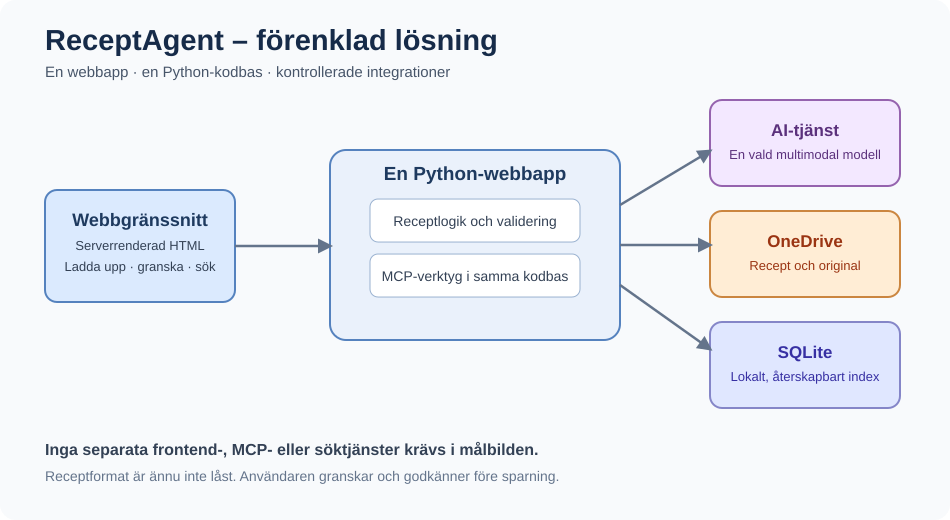

# ReceptAgent – Intelligent digital receptsamling

**Projektpaket | Version 0.1 | 2026-10-21**

> Från handskrivna receptlappar till ett sökbart receptbibliotek med AI-chatt, OneDrive och MCP.

## Starta här

1. [Idé, problem och målbild](docs/01-IDE-OCH-MALBILD.md)
2. [High Level Design (HLD)](docs/02-HLD.md)
3. [Detailed Level Design (DLD)](docs/03-DLD.md)
4. [Arkitekturbeslut och öppna frågor](docs/04-ARKITEKTURBESLUT.md)
5. [Krav, verifiering och demo](docs/05-UTVECKLINGSPLAN.md)
6. [API- och MCP-kontrakt](docs/06-API-OCH-MCP.md)
7. [AI-agentens utvecklingsbrief](docs/07-UTVECKLINGSBRIEF.md)
8. [Riktlinjer för plattform och leverans](docs/08-PLATTFORM-OCH-LEVERANS.md)

## Projektidé i en mening
Fotografera eller skanna pappersrecept, låt AI tolka dem, granska och spara godkända recept i OneDrive `/Recept/`; sök och samtala sedan med den egna receptsamlingen via en AI-agent som använder kontrollerade MCP-verktyg. Det beständiga receptformatet är ännu inte valt.

## Levererat i detta paket
- Komplett arkitekturunderlag i Markdown med Mermaid-diagram
- Fristående SVG-översikt för presentationer
- Testunderlag med receptbilder och referensexempel på utdata i Markdown och JSON
- Krav, verifieringskriterier och demoscenario
- Övergripande riktlinjer för GitHub, CI/CD och Azure
- Förslag på REST-API och MCP-verktyg

**Status:** Planeringsunderlag, inte en implementerad applikation. Beslut om Microsoft-kontotyp, autentiseringsflöde och AI-leverantör behöver bekräftas innan kodning.

## Visa diagram
Mermaid-kodblock visas i exempelvis VS Code med lämpligt Mermaid-stöd, GitHub och många Markdown-visare. Arkitekturen finns också som `assets/architecture.svg` som kan öppnas direkt.
