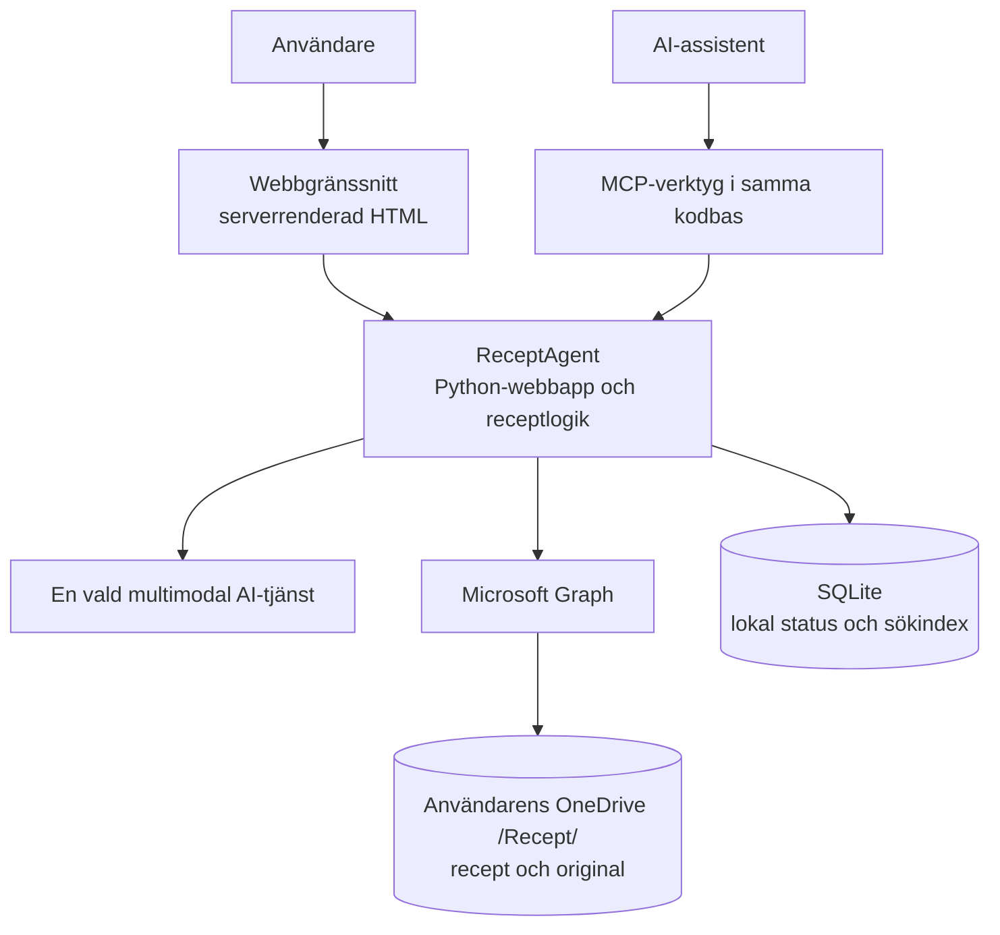

# 02 – Översiktlig lösningsdesign

## Designprinciper

- Bygg som en liten, sammanhållen webbapplikation – inte som flera driftsatta tjänster.
- Återanvänd samma receptlogik från webbgränssnitt, AI-assistent och MCP-verktyg.
- Låt OneDrive vara den beständiga platsen för användarens godkända recept och original.
- Håll ett lokalt sökindex enkelt och återskapbart; det är inte en konkurrerande källa.
- Låt användaren granska och godkänna AI-genererat innehåll innan det sparas.
- Välj en konkret AI-modell och integrationsväg för demon. Undvik flerleverantörsramverk
  tills det finns ett faktiskt behov.
- Håll lagringsformatet öppet tills det har prövats mot testfallen och användarbehovet.

## Föreslagen struktur

En Python-applikation hanterar webbgränssnitt, validering, receptflöden och åtkomst till
integrationerna. Gränssnittet renderas på servern med HTML-mallar; JavaScript används
bara där det tillför ett tydligt värde, exempelvis för förhandsvisning av en bild.
MCP-verktygen ligger i samma kodbas och anropar samma receptfunktioner. De är inte en
separat tjänst.

## Huvudflöden

### Tolka och spara recept

1. Användaren laddar upp ett foto eller en PDF.
2. Applikationen kontrollerar filtyp och storlek och visar originalet.
3. En vald multimodal modell föreslår strukturerade receptfält.
4. Applikationen validerar svaret och markerar osäker eller saknad information.
5. Användaren granskar och rättar uppgifterna.
6. Efter uttryckligt godkännande sparas recept och original i OneDrive.
7. Det lokala sökindexet uppdateras. Fel i lagring eller indexering visas tydligt och
   får inte rapporteras som lyckad publicering.

### Söka och fråga

Webbgränssnittet och AI-assistenten använder samma recepttjänst för att söka och läsa
recept. MCP exponerar endast namngivna, typade funktioner för dessa operationer.
Assistentens svar hänvisar till använda recept och skiljer källuppgifter från förslag.

### Ändringar i OneDrive

Användaren ska kunna begära att biblioteket läses in eller synkroniseras på nytt.
Ändrade filer valideras innan indexet uppdateras. Om en fil har ändrats sedan appen senast
läste eller sparade den ska en konflikt visas; ingen ändring skrivs över tyst.
Kontinuerlig bakgrundssynkronisering och avancerad delta-synk är inte ett förhandskrav.

## Ansvarsgränser

| Del | Ansvar |
|---|---|
| Webbgränssnitt | Uppladdning, granskning, korrigering, bibliotek, sökning och chatt |
| Applikation | Validering, receptflöden, behörighetskontroll och tydliga fel |
| AI-integration | Extraktion och språkmodellsvar via en vald modell |
| OneDrive-integration | Läsa och spara användarens filer i `/Recept/` med delegerad åtkomst |
| SQLite | Lokal jobb-/indexmetadata och sökning; kan återskapas från beständiga filer |
| MCP | Begränsad, typad åtkomst till receptfunktioner via samma applikationslogik |

## Icke-funktionella krav

- Webbflödet ska fungera i en vanlig modern webbläsare och på mobilskärm.
- Varje användares åtkomst begränsas till den identitet och OneDrive som autentiserats.
- Uppladdade filer, AI-fel, Graph-fel och konflikter får inte försvinna tyst.
- Receptdata ska kunna kopplas till OneDrive-fil och ursprungligt dokument.
- Svar om användarens samling ska ha källhänvisningar och inte låtsas vara verifierade
  när receptdata inte gick att hämta.
- Applikationen ska kunna köras lokalt för demo utan att kräva en distribuerad
  tjänstearkitektur.
